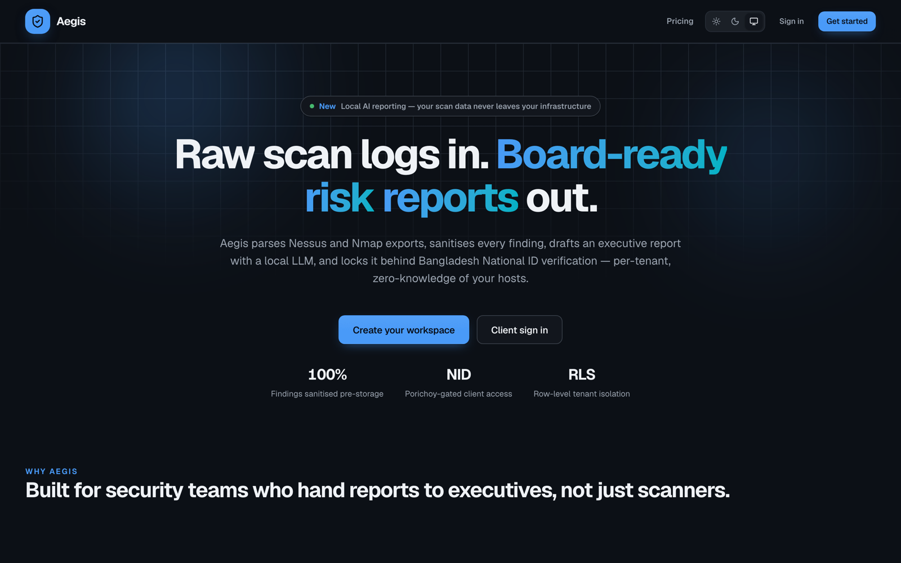
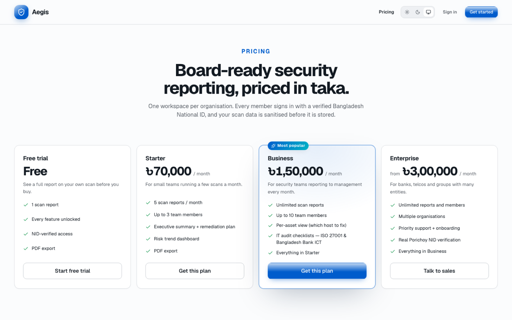

# Aegis — Vulnerability Intelligence Portal

**Raw scan logs in. Board-ready risk reports out.**

Aegis is a multi-tenant web portal for security teams. An admin uploads a raw Nessus or Nmap export, the backend sanitises every finding before anything is stored, a local LLM drafts an executive summary and remediation plan, and the client reads the finished report (and exports it as a PDF) after a one-time Bangladesh National ID check.

**Live demo:** https://aegis-portal-navy.vercel.app



> A self-initiated product built solo by [Rimon Debnath](https://rimon-portfolio.vercel.app). Demo deployments can run NID checks in mock mode, and reports fall back to the rules engine whenever no Ollama server is reachable.

## Features

- **Scan ingest:** `.nessus`, Nmap XML and JSON exports, dropped straight from the scanner (drag and drop, size-capped).
- **Sanitise first, store second:** IPs, hostnames, MAC addresses, credentials and emails are redacted by the parser. Raw files are never persisted.
- **Local AI reports:** a Llama 3.2 model on your own Ollama server writes the executive summary and remediation plan as strict JSON. Nothing goes to a third-party AI API. Without a reachable model, a built-in rules engine writes a clearly labelled summary instead.
- **Tenant isolation:** every table is protected by Postgres row-level security, so a client only ever reads its own organisation's rows.
- **National ID gate:** client access is unlocked by a one-time Porichoy NID + date-of-birth check. The NID is held in memory only; the profile stores a boolean flag.
- **Encrypted per-asset view:** the real host behind each finding is stored AES-256-GCM encrypted, and only admins on eligible plans can see which host to fix.
- **IT audit checklists:** ISO/IEC 27001:2022 readiness and Bangladesh Bank ICT readiness, with weighted scoring, autosave, domain bars and top gaps. (Readiness checks, not official certification.)
- **Dashboards and export:** risk score, severity donut, risk trend, and one-click executive PDF export.
- **Plans:** pricing in BDT with per-plan report quotas enforced on upload.
- **UI:** responsive app shell (sidebar, tablet rail, phone drawer), light/dark/system theme, skeleton loading states, toasts.



## Architecture

```
Browser ──► Next.js 16 web app (Vercel)
              │  reads through the Supabase publishable key (RLS applies)
              │  writes through server actions / route handlers (secret key)
              │
              ├──► Supabase: Postgres + RLS, Auth
              │
              └──► FastAPI ingest backend (Vercel or Docker)
                     parse → sanitise → store findings → draft report (Ollama or rules engine)
                     → mark the report row ready / failed
```

The web app forwards an uploaded file to `POST /api/v1/ingest` with a shared bearer token. The backend writes results back to the report row with the service-role key. Hosted backends refuse uploads when `INTERNAL_TOKEN` is unset.

## Stack

| Layer | Tech |
| --- | --- |
| Web | Next.js 16 (App Router), React 19, TypeScript, Radix UI, Recharts, GSAP, React-PDF, Zod, nuqs |
| Data / auth | Supabase (Postgres, row-level security, Auth) |
| Backend | Python 3.12, FastAPI, uvicorn, supabase-py, uv |
| AI | Ollama with `llama3.2:3b` (local), rules-engine fallback |
| Hosting | Vercel (web and backend), Dockerfile + `render.yaml` for Render or any Docker host |

## Repository layout

```
web/        Next.js app (landing, pricing, auth, dashboard, reports, risk, audits, admin)
backend/    FastAPI ingest service (parser, sanitiser, AI drafting, AES-GCM asset map)
supabase/   schema.sql + migrations
```

## Running locally

1. **Database:** create a Supabase project, then run `supabase/schema.sql` and `supabase/migrations/002_plans_assets_audits.sql` in the SQL editor.
2. **Backend:** see [`backend/README.md`](backend/README.md). In short: `ollama pull llama3.2:3b`, copy `backend/.env.example` to `.env`, then `uv sync && uv run uvicorn aegis_backend.main:app --port 8000`.
3. **Web:** copy `web/.env.example` to `web/.env.local` and fill in the Supabase keys, `BACKEND_URL`, the shared token and `ASSET_ENCRYPTION_KEY` (same value as the backend). Then:

   ```bash
   cd web
   npm install
   npm run dev
   ```

   Leave `PORICHOY_API_KEY` empty in development to use mock NID verification. `BOOTSTRAP_ADMIN_EMAIL` is promoted to admin on sign-up.

4. Try it with the sample scan in `backend/demo-scan.nessus`.

## Deploying

- **Web:** a Vercel project with root `web/`. Set `NEXT_PUBLIC_MAX_UPLOAD_MB=4` (Vercel's request body limit is 4.5 MB).
- **Backend:** its own Vercel project from `backend/` (FastAPI preset via `vercel.json`), or Docker / Render with `render.yaml`.
- Set `PORICHOY_MOCK=true` only on demo deployments; production without a Porichoy key blocks verification.

## Privacy model

- Raw scan files are never written to disk or the database; only sanitised findings are stored.
- The LLM prompt contains sanitised titles, severities and counts only.
- National ID numbers are never persisted, logged or put in cookies.
- The per-asset host map is encrypted at rest with AES-256-GCM.

## Author

Built by **Rimon Debnath**, software engineer (Next.js, TypeScript, Python, AI).
Portfolio: https://rimon-portfolio.vercel.app · GitHub: [@Rimonok12](https://github.com/Rimonok12)
